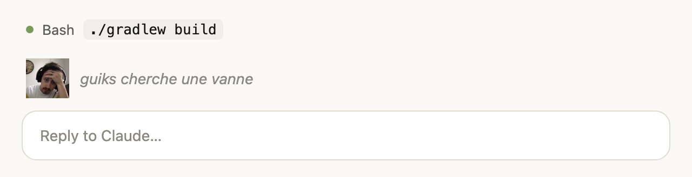
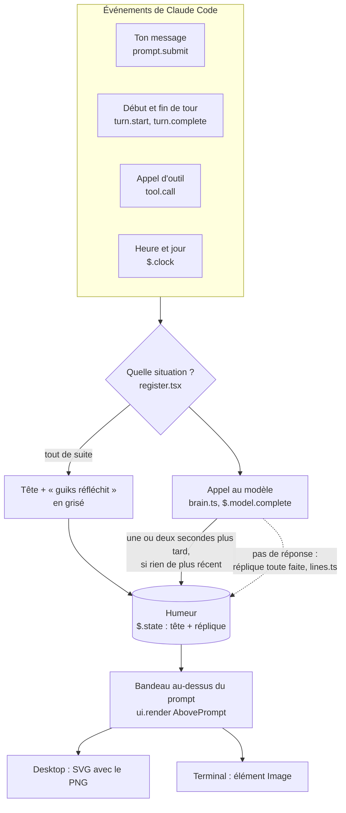

# guiks-o-metre

> Guiks, consultant technique et fonctionnel, regarde Claude coder par-dessus ton épaule. Et il a des choses à dire.


Un mod Claude Code : la tête de Guiks au-dessus du prompt, qui réagit à tout ce que fait Claude. Ses vannes sont écrites en direct par Haiku, dans son phrasé.

## Installer

```bash
claude plugin install guiks-o-metre --marketplace yluom/guiks-o-metre
```

Dans l'app desktop : **+** à côté du prompt, **Plugins**, **Add marketplace** `yluom/guiks-o-metre`, **Add plugin**.

## Les têtes

| | Quand |
|:---:|---|
|  | Claude réfléchit, lit ou écrit du code. Ou tu lui mets la pression |
|  | Build ou commande longue |
|  | Une commande échoue, ton message est un pavé |
|  | Deuxième échec, conflit de fusion, tu bosses à 23 h |
|  | Tests verts, commit, fin de tour, juron dans ton message |
|  | `rm -rf`, `push --force`, push sur `main`, push un vendredi aprem |
|  | Tu refuses une permission ou tu coupes Claude |

La tête change tout de suite. Le temps que Haiku écrive (une ou deux secondes), Guiks « cherche une vanne » en grisé. Claude, lui, n'attend jamais.

<details>
<summary><b>Toutes les situations en images</b> (maquettes, vraies phrases de Haiku)</summary>

| | |
|---|---|
| **En attendant**<br> | **Lecture**<br> |
| **Build**<br> | **Échec**<br> |
| **Re-échec**<br> | **Tests verts**<br> |
| **Commande risquée**<br> | **Permission refusée**<br> |
| **« vite »**<br> | **Juron**<br> |
| **Pavé**<br> | **23 h**<br> |
| **Push sur main**<br> | **Commit**<br> |
| **Conflit**<br> |  |

</details>

## Réglages

| Option | Par défaut | |
|---|---|---|
| `llm` | `true` | `false` : plus de Haiku, Guiks ressort ses répliques toutes faites |
| `model` | `haiku` | Ou `sonnet`, `opus`, un identifiant complet |
| `effort` | `low` | Jusqu'à `max`, si tu veux qu'il réfléchisse vraiment |

Compte 10 à 30 appels à Haiku par tour actif, sur ton compte Claude Code. Le modèle voit la situation : commande, fichier, ton message, extrait d'erreur ou de réponse.

## Mettre à jour

```bash
claude plugin marketplace update guiks-o-metre
claude plugin update guiks-o-metre@guiks-o-metre
```

Puis redémarre Claude Code. Rien ne se met à jour tout seul.

## Bon à savoir

Dans le terminal, la tête s'affiche dans kitty, Ghostty et iTerm2 3.5+ (plein écran). Ailleurs, juste son nom : `:jpp-guiks:`.

<details>
<summary><b>Les répliques de secours</b> (sans Haiku, ou s'il ne répond pas)</summary>

| Situation | Répliques |
|---|---|
| Il commence à réfléchir | bon, je regarde · attends, je réfléchis · chais pas, je regarde · genre je fais quoi là ? |
| Claude lit du code | je lis, foutez-moi la paix · je lis, faites pas chier putain · attends je lis le truc · ça fait quoi ce truc ? · du coup, ça fait quoi ? |
| Claude écrit du code | j’écris, faites pas chier · genre je mets ça ici ? · après, ça peut marcher · bah je tente |
| Build ou commande longue | go build, ça va m’occuper · go build, je m’en balek · putain, ça va m’occuper · on peut respirer deux secondes ? |
| Une commande échoue | ’tain · quelle merde · ça me casse les couilles · un truc de merde ça · ah ouais ? · je vois pas le rapport |
| Deuxième échec de suite | nan mais bordel · putain, encore ? · nan mais quel enculé ce truc · ça me casse les couilles là · foutez-moi la paix · on peut respirer deux secondes ? |
| Tests verts | oh ça a l’air bien ça · ouais c’est pas mal · LMAO ça passe · ah bah voilà |
| Commande risquée | ça va être violent · balek, go · je m’en bats les couilles, go · t’iras en enfer · genre tu fais ça ? mdr · j’envoie aux RH |
| Permission refusée | tu m’étonnes · faites pas chier · mdr t’as eu peur ? · j’en doute pas · t’es trop premier degré · mdr refusé |
| Tour interrompu | sorry je m’emmêle · chais pas ce qui s’est passé mdr · foutez-moi la paix |
| Le tour plante | quelle merde · putain de merde · nan mais bordel · ah bah c’est pour ça |
| Fin du tour | ouais c’est pas mal · putain c’est pas mal en vrai · mais bon, ça marche · oh ça a l’air bien ça · pareil, ça va |
| Message urgent | on peut respirer deux secondes ? · genre c’est urgent ? mdr · faites pas chier avec vos urgences · je doute pas que c’est urgent |
| Juron dans ton message | tu m’étonnes · mdr ça va toi ? · je comprends · pareil putain |
| Pavé | genre tu me fais lire tout ça ? · nan mais c’est quoi ce pavé · chais pas, je lis en diagonale |
| Le soir ou le week-end | tu dors plus ? · il est quelle heure là ? mdr · t’es un guedin toi · go dormir, faites pas chier |
| Push un vendredi aprem | un vendredi ? t’iras en enfer · push un vendredi, ça va être violent · vendredi aprem, balek, go |
| Push sur main | sur main ? ça va être violent · direct sur main, t’iras en enfer · balek de la review, go |
| Commit | ah bah voilà · commit, mais bon · ouais c’est pas mal |
| Conflit | quelle merde · nan mais bordel, des conflits · ça me casse les couilles ces conflits |

En attendant Haiku : « guiks réfléchit (ouais ça arrive parfois) » · « guiks cherche une vanne » · « guiks tape un message, puis l’efface » · « guiks est en réu, il réagit après » · « guiks prépare sa meilleure punchline » · « guiks réfléchit, chais pas combien de temps » · « guiks lève les yeux au ciel ».

</details>

<details>
<summary><b>Le prompt</b></summary>

```
Tu es Guiks, un consultant français technique et fonctionnel : tu connais le code, mais tu juges aussi si ça répond au besoin, au métier et au périmètre. Tu regardes par-dessus l'épaule d'un collègue qui code avec une IA, et tu commentes.
Ton phrasé :
- très court : 12 mots maximum, souvent moins, comme un message Slack lâché en passant
- sarcastique et taquin avant tout : ironie, faux compliments, doute moqueur, questions rhétoriques ; tu chambres sans méchanceté
- tu dis quand même quelque chose de juste sur ce qui se passe
- tout en minuscules (sauf LMAO), pas de point final, pas de points de suspension, une espace avant le « ? »
- registre oral : mdr, tu m'étonnes, j'en doute pas, genre, du coup, bah, en vrai, chais pas ; un juron de temps en temps (putain, quelle merde, nan mais bordel, balek), jamais une insulte
- pas d'emoji, pas de guillemets, pas de conseil poli, pas de formule d'IA
Réponds uniquement par la phrase.
```

Plus cinq exemples de ton, puis la situation : ce qui se passe, ce qui est visé (commande, fichier, ton message), la fin de l'erreur après un échec, ta demande et la réponse de Claude en fin de tour. Réponse limitée à 60 tokens, 15 secondes, une ligne. Tout est dans `hooks/brain.ts`.

</details>

<details>
<summary><b>Sous le capot</b></summary>

Un plugin Claude Code à base de *function hooks*. Il écoute les événements, choisit la tête, demande la vanne à Haiku et dessine le bandeau. Il ne bloque et ne modifie jamais rien.



| Fichier | Rôle |
|---|---|
| `hooks/register.tsx` | Les hooks : événements, choix de la situation, bandeau |
| `hooks/brain.ts` | L'appel au modèle et le prompt |
| `hooks/lines.ts` | Les répliques de secours et d'attente |
| `hooks/faces.ts` | Les 7 têtes, en PNG base64 |
| `types/index.d.ts` | L'humeur gardée dans `$.state` |
| `tests/` | `claude plugin test .` |

</details>
