# guiks-o-metre

Un mod Claude Code : une tête de Guiks, consultant technique et fonctionnel, s'affiche au-dessus du prompt et commente ce que fait Claude, avec son phrasé.

## Aperçus

Rendus du bandeau au-dessus du prompt (maquettes, pas des captures de l'app). Quand c'est une commande qui fait réagir Guiks, elle apparaît au-dessus ; quand c'est ton message, il apparaît dans le champ de saisie.

| | |
|---|---|
| Claude lit du code<br>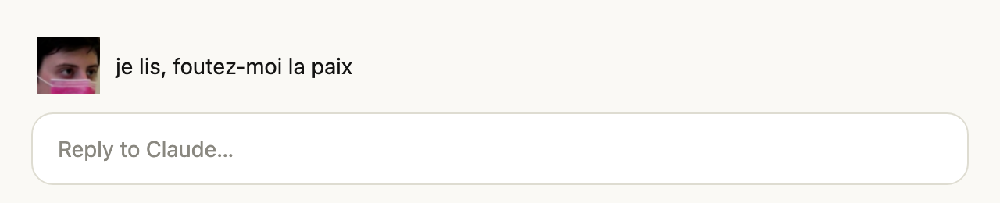 | Build en cours<br>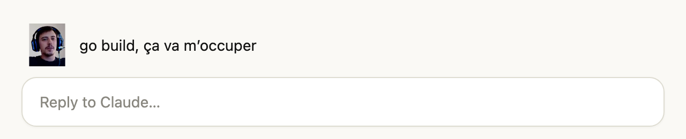 |
| Une commande échoue<br>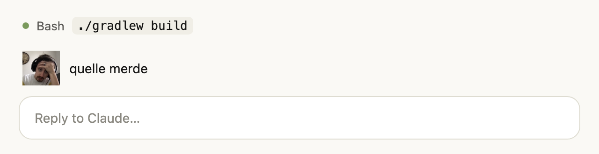 | Deuxième échec de suite<br>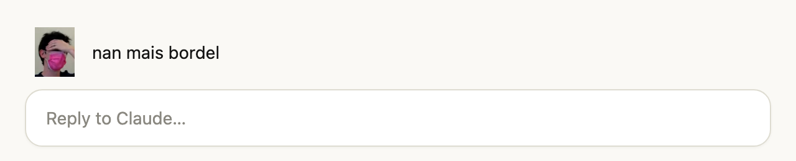 |
| Des tests passent<br>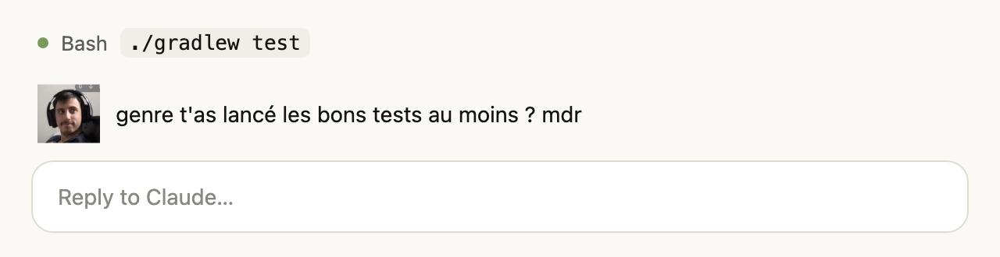 | Commande risquée<br>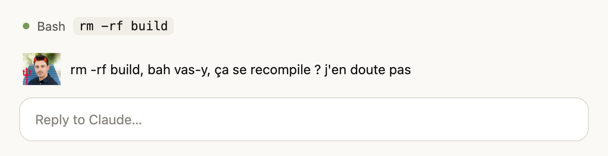 |
| Permission refusée<br>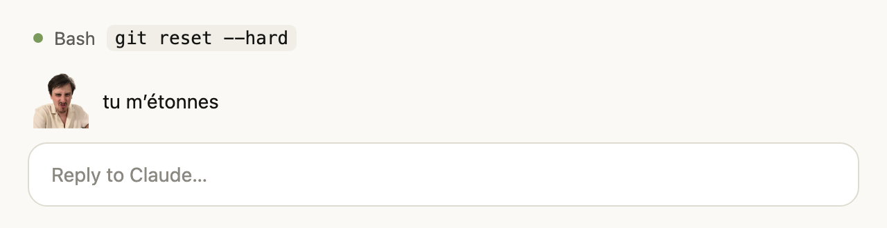 | Ton message est urgent<br>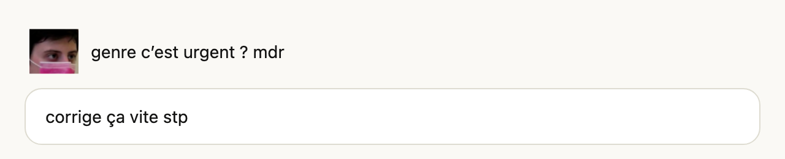 |
| Ton message contient un juron<br>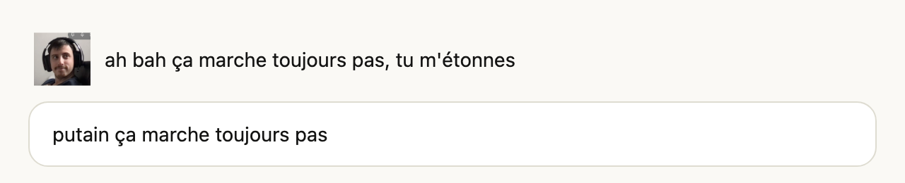 | Ton message est un pavé<br>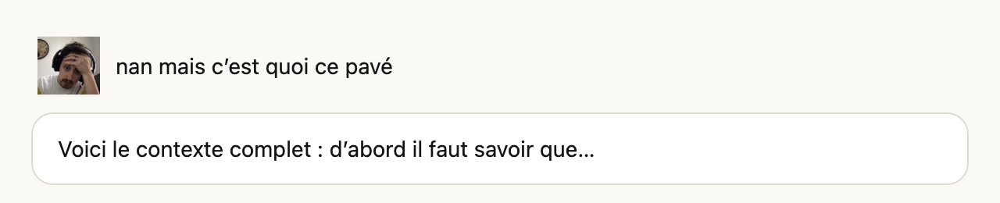 |
| Message du soir<br>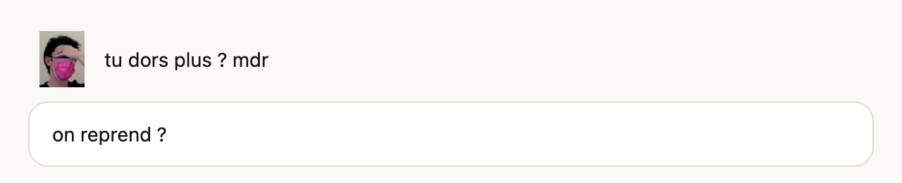 | Push un vendredi après-midi<br>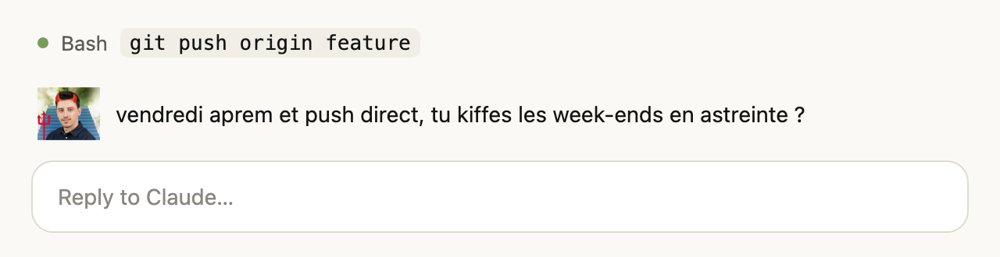 |
| Push vers main<br>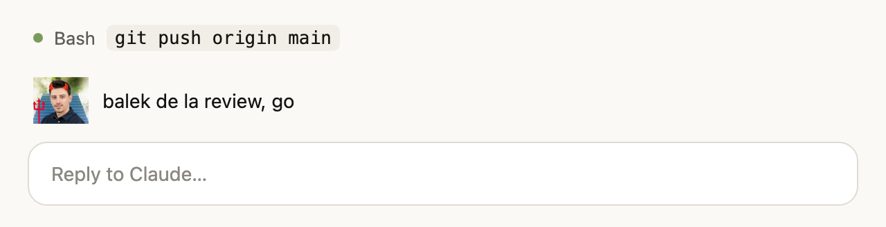 | Commit réussi<br>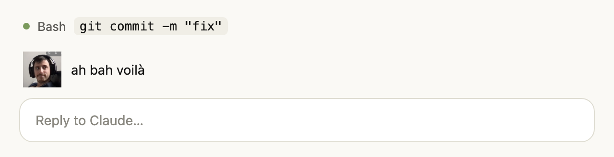 |
| Conflit de fusion<br>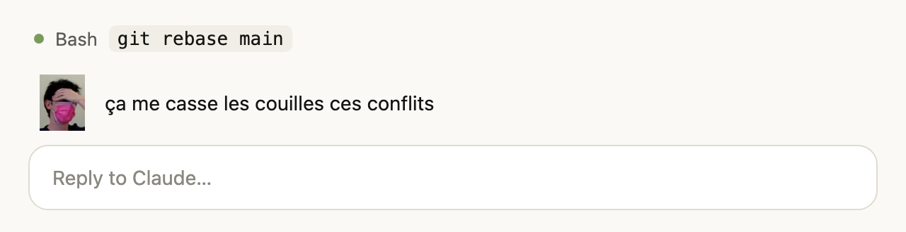 |  |

## Situations et répliques

| Situation | Tête | Répliques |
|---|:---:|---|
| Au repos |  | « j’observe, faites pas chier » |
| Début d'un tour |  | « bon, je regarde » · « attends, je réfléchis » · « chais pas, je regarde » · « genre je fais quoi là ? » |
| Claude lit du code |  | « je lis, foutez-moi la paix » · « je lis, faites pas chier putain » · « attends je lis le truc » · « ça fait quoi ce truc ? » · « du coup, ça fait quoi ? » |
| Claude écrit du code |  | « j’écris, faites pas chier » · « genre je mets ça ici ? » · « après, ça peut marcher » · « bah je tente » |
| Build ou commande longue (gradle, npm, docker…) |  | « go build, ça va m’occuper » · « go build, je m’en balek » · « putain, ça va m’occuper » · « on peut respirer deux secondes ? » |
| Une commande échoue |  | « ’tain » · « quelle merde » · « ça me casse les couilles » · « un truc de merde ça » · « ah ouais ? » · « je vois pas le rapport » |
| Deuxième échec de suite |  | « nan mais bordel » · « putain, encore ? » · « nan mais quel enculé ce truc » · « ça me casse les couilles là » · « foutez-moi la paix » · « on peut respirer deux secondes ? » |
| Des tests passent |  | « oh ça a l’air bien ça » · « ouais c’est pas mal » · « LMAO ça passe » · « ah bah voilà » |
| Commande risquée (`rm -rf`, `push --force`, `reset --hard`, `DROP TABLE`…) |  | « ça va être violent » · « balek, go » · « je m’en bats les couilles, go » · « t’iras en enfer » · « genre tu fais ça ? mdr » · « j’envoie aux RH » |
| Permission refusée |  | « tu m’étonnes » · « faites pas chier » · « mdr t’as eu peur ? » · « j’en doute pas » · « t’es trop premier degré » · « mdr refusé » |
| Tour interrompu |  | « sorry je m’emmêle » · « chais pas ce qui s’est passé mdr » · « foutez-moi la paix » |
| Le tour plante |  | « quelle merde » · « putain de merde » · « nan mais bordel » · « ah bah c’est pour ça » |
| Fin du tour sans échec |  | « ouais c’est pas mal » · « putain c’est pas mal en vrai » · « mais bon, ça marche » · « oh ça a l’air bien ça » · « pareil, ça va » |
| Ton message dit « urgent », « vite » ou « asap » |  | « on peut respirer deux secondes ? » · « genre c’est urgent ? mdr » · « faites pas chier avec vos urgences » · « je doute pas que c’est urgent » |
| Ton message contient un juron |  | « tu m’étonnes » · « mdr ça va toi ? » · « je comprends » · « pareil putain » |
| Ton message est un pavé |  | « genre tu me fais lire tout ça ? » · « nan mais c’est quoi ce pavé » · « chais pas, je lis en diagonale » |
| Premier message du soir (après 20 h), de la nuit ou du week-end |  | « tu dors plus ? » · « il est quelle heure là ? mdr » · « t’es un guedin toi » · « go dormir, faites pas chier » |
| Push ou déploiement un vendredi après-midi |  | « un vendredi ? t’iras en enfer » · « push un vendredi, ça va être violent » · « vendredi aprem, balek, go » |
| `git push` vers `main` |  | « sur main ? ça va être violent » · « direct sur main, t’iras en enfer » · « balek de la review, go » |
| Commit réussi |  | « ah bah voilà » · « commit, mais bon » · « ouais c’est pas mal » |
| Conflit de fusion |  | « quelle merde » · « nan mais bordel, des conflits » · « ça me casse les couilles ces conflits » |

Les moments forts déclenchent aussi une notification. Chaque situation tire une réplique au hasard parmi plusieurs, dans le phrasé de Guiks (voir `hooks/lines.ts`).

## L'avis de Guiks par un modèle

En plus des répliques toutes faites, Guiks donne son avis grâce à un petit modèle (Haiku par défaut) :

- **quand une commande échoue**, il lit la fin de l'erreur et dit ce qui cloche, à sa façon (« nan mais bordel, ton null traîne ligne 42 ») ;
- **à la fin de chaque tour**, il lit ta demande et un extrait de la réponse de Claude, et dit ce qu'il en pense. En consultant technique et fonctionnel, il juge le code, mais aussi si ça répond au besoin et au périmètre (« genre le métier t'a demandé ça ? j'en doute pas mdr »).

La réplique toute faite s'affiche tout de suite ; l'avis du modèle la remplace dès qu'il arrive (en général une ou deux secondes). Si une autre réaction est passée entre-temps, ou si le modèle ne répond pas, la réplique toute faite reste. Claude n'attend jamais le modèle.

Chaque avis est un appel au modèle, sur le même compte que ta session Claude Code, avec ta demande, un extrait de la réponse ou de l'erreur. Les options du plugin règlent tout ça :

| Option | Par défaut | Rôle |
|---|---|---|
| `llm` | `true` | Active ou coupe les avis du modèle |
| `model` | `haiku` | Alias (`haiku`, `sonnet`, `opus`) ou identifiant complet |
| `effort` | `low` | `low`, `medium`, `high`, `xhigh` ou `max` |

### Le prompt

Le modèle reçoit une consigne fixe, puis un message qui décrit la situation. Tout est dans `hooks/brain.ts`.

La consigne fixe :

```
Tu es Guiks, un consultant français technique et fonctionnel : tu connais le code, mais tu juges aussi si ça répond au besoin, au métier et au périmètre. Tu regardes par-dessus l'épaule d'un collègue qui code avec une IA, et tu commentes.
Ton phrasé :
- une seule phrase, 25 mots maximum, comme un message Slack entre potes
- tout en minuscules (sauf LMAO), pas de point final, pas de points de suspension, une espace avant le « ? »
- registre oral et cru : putain, 'tain, quelle merde, nan mais bordel, balek, ça me casse les couilles, mdr, tu m'étonnes, j'en doute pas, genre, du coup, bah, après, en vrai, chais pas, t'es un guedin
- tu chambres, tu doutes ironiquement, tu poses des questions rhétoriques, mais tu dis quand même quelque chose de juste sur ce qui se passe
- pas d'emoji, pas de guillemets, pas de conseil poli, pas de formule d'IA
Réponds uniquement par la phrase.
```

Suivie de cinq exemples de ton. Le message de situation contient :

- après un échec : la commande (400 caractères au plus) et la fin de sa sortie (1 500 caractères) ;
- en fin de tour : ta demande (800 caractères), la fin de la réponse de Claude (1 500 caractères), la durée du tour, le nombre d'appels d'outils et d'échecs.

La réponse est limitée à 120 tokens et 15 secondes. Le mod n'en garde que la première ligne, sans guillemets ni point final, coupée à 220 caractères.

## Installation

À l'invite d'une session Claude Code dans un terminal :

```
/plugin install guiks-o-metre --marketplace yluom/guiks-o-metre
```

Répondre `y` pour ajouter le marketplace, puis choisir la portée.

Depuis un shell :

```bash
claude plugin install guiks-o-metre --marketplace yluom/guiks-o-metre
```

Dans l'app desktop, où `/plugin` ne marche pas : cliquer sur + à côté du champ de saisie, puis Plugins, Add marketplace avec `yluom/guiks-o-metre`, puis Add plugin.

## Affichage

- App desktop : l'image s'affiche.
- Terminal : l'image s'affiche dans kitty, Ghostty et iTerm2 3.5 et plus (en plein écran). Ailleurs, le nom de l'emoji s'affiche à la place, avec la même phrase.

## Technique

Le mod est un plugin Claude Code à base de *function hooks* : un module TypeScript qui s'abonne à des événements de Claude Code. Chaque hook regarde l'événement, met à jour l'humeur de Guiks, puis laisse Claude Code continuer normalement (`next(e)`). Le mod ne bloque et ne modifie jamais rien.

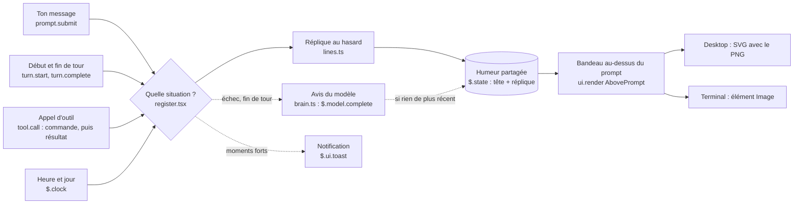

1. **Les événements.** Le mod écoute ton message (`prompt.submit`), le début et la fin de chaque tour (`turn.start`, `turn.complete`) et chaque appel d'outil (`tool.call`). Pour un appel d'outil, il voit la commande avant qu'elle parte, puis son résultat (succès, échec, refus).
2. **Le choix de la situation.** Des expressions régulières reconnaissent les cas : commande risquée, build, tests, `git commit`, conflit, push vers `main`, mots « urgent » ou jurons dans ton message. L'horloge sert pour le vendredi après-midi et les heures tardives.
3. **L'humeur.** La tête et la réplique choisies sont rangées dans l'état du plugin (`$.state`). Les écrire suffit à redessiner le bandeau, sans autre appel.
4. **Le dessin.** Un hook `ui.render` dessine le bandeau au-dessus du prompt. L'app desktop reçoit un SVG qui contient le PNG ; le terminal reçoit un élément `Image`, que seuls certains terminaux savent afficher.
5. **L'avis du modèle.** Après un échec ou à la fin d'un tour, le mod programme un appel à `$.model.complete` avec `$.clock.after`, pour ne pas retarder Claude. La réponse remplace la réplique seulement si aucune réaction plus récente n'est passée (un compteur d'humeur le vérifie).

| Fichier | Rôle |
|---|---|
| `.claude-plugin/plugin.json` | Nom et description du plugin |
| `.claude-plugin/marketplace.json` | Fait du dépôt un marketplace installable |
| `hooks/hooks.json` | Désigne le module de hooks |
| `hooks/register.tsx` | Les hooks : événements, choix de la situation, dessin du bandeau |
| `hooks/lines.ts` | Les répliques, rangées par situation |
| `hooks/brain.ts` | L'appel au modèle : consigne de style, demande, nettoyage de la réponse |
| `hooks/faces.ts` | Les 7 têtes, en PNG encodés en base64 |
| `types/index.d.ts` | Le type de l'humeur gardée dans `$.state` |
| `tests/` | Tests lancés avec `claude plugin test .` |
